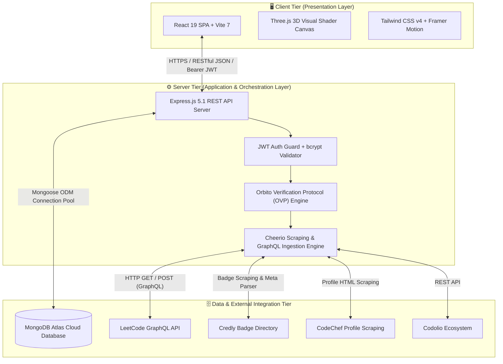

<div align="center">

# 🪐 Orbito

### **Unified Developer Intelligence & Digital Badge Aggregation Platform**
*All Your Verified Coding Achievements, Badges, and Skill Milestones in One Powerful Dashboard.*

<br/>

[](https://badger-orbito-frontend.vercel.app/)
[](LICENSE)
[](https://react.dev/)
[](https://vitejs.dev/)
[](https://tailwindcss.com/)
[](https://expressjs.com/)
[](https://www.mongodb.com/)
[](https://threejs.org/)

<br/>

[**Explore Live App »**](https://badger-orbito-frontend.vercel.app/) · [**Report Bug**](https://github.com/phoenixdev100/badger-orbito/issues) · [**Request Feature**](https://github.com/phoenixdev100/badger-orbito/issues)

---

</div>

## 📌 Executive Summary

Modern software engineers, competitive programmers, and technical students build their skills across disparate, siloed ecosystems—**LeetCode**, **Credly**, **CodeChef**, **HackerRank**, **Codolio**, and **GitHub**. However, consolidating these verified accomplishments onto resumes or portfolios has traditionally been fragmented, time-consuming, and prone to credential inflation.

**Orbito** solves this fragmentation by providing an automated, real-time developer intelligence engine. With the proprietary **Orbito Verification Protocol (OVP)**, zero-credential platform ownership validation, and real-time GraphQL scraping pipelines, Orbito converts scattered badges into a unified, authenticated, tamper-proof developer portfolio.

---

## ✨ Key Features

- 🛡️ **Orbito Verification Protocol (OVP)**: Zero-credential account ownership validation without requiring sensitive third-party login credentials or private access tokens.
- ⚡ **Multi-Platform Real-Time Aggregator**:
  - **LeetCode**: High-speed GraphQL queries fetching global rankings, contest ratings, and solved problem tallies categorized by difficulty (Easy / Medium / Hard).
  - **Credly**: Direct verification of accredited enterprise certifications (AWS, Microsoft, Google Cloud, Meta, IBM).
  - **CodeChef**: Profile parsing extracting star ratings and global rank data.
  - **Codolio & GitHub**: Developer activity, repository impact, and commit telemetry.
- 🎨 **Next-Gen 3D Presentation Layer**: Engineered with **React 19**, **Vite 7**, **Tailwind CSS v4**, and custom **Three.js** GLSL interactive particle shaders.
- 🔒 **Hardened Security & Privacy**:
  - Salting and hashing with `bcrypt` (work factor 10).
  - Stateless JSON Web Token (`JWT`) authentication guards.
  - Multi-tiered `.gitignore` repository protection preventing secret leakage.
- 🔄 **Mutual-Exclusivity Aggregation Algorithm**: Deduplicates overlapping badges across providers and standardizes them into normalized JSON schemas.
- 📱 **Fully Responsive Glassmorphic UI**: High-framerate responsive design optimized for desktops, tablets, and smartphones.

---

## 🛠️ Technology Stack

| Domain | Technology | Purpose |
| :--- | :--- | :--- |
| **Frontend Framework** | **React 19 (SPA)** | High-concurrency UI rendering with modern React Hooks |
| **Build Tool** | **Vite 7** | Lightning-fast Hot Module Replacement (HMR) and optimized bundler |
| **Styling** | **Tailwind CSS v4** | Modern utility-first responsive styling and animated gradients |
| **3D Graphics** | **Three.js** | Custom WebGL interactive visual particle shaders |
| **Backend Runtime** | **Node.js 18+** | High-throughput asynchronous event-driven JavaScript runtime |
| **Server Framework** | **Express.js 5.1** | Modular RESTful API routing, rate limiting, and middleware pipeline |
| **Database** | **MongoDB Atlas** | Cloud-native NoSQL document database with high availability |
| **ODM Layer** | **Mongoose 8** | Strict schema validation, index enforcement, and document mapping |
| **Scraping & Ingestion**| **Cheerio + Axios** | HTML parsing engine and low-latency HTTP/GraphQL client |
| **Authentication** | **JWT + bcrypt** | Cryptographic token exchange and salted password storage |
| **Hosting & Cloud** | **Vercel Cloud** | Global CDN edge caching and serverless execution tier |

---

## 🏗️ System Architecture

Orbito employs a decoupled **Three-Tier Architecture**:



---

## 📂 Project Structure

```text
badger-orbito/
├── client/                     # Frontend Application (React 19 + Vite 7)
│   ├── public/                 # Static assets, favicons, logos
│   ├── src/
│   │   ├── assets/             # Images, platform icons, vectors
│   │   ├── components/         # Modular React UI components
│   │   │   ├── ui/             # Animated tooltips, 3D canvases, modals
│   │   │   ├── Navbar.jsx      # Navigation bar
│   │   │   ├── Footer.jsx      # Footer with social & copyright links
│   │   │   ├── Platforms.tsx   # Verified platforms grid
│   │   │   └── MeetTeam.jsx    # Leadership showcase
│   │   ├── context/            # Global state (Auth & User context)
│   │   ├── pages/              # Routed pages (Home, Dashboard, Verify)
│   │   ├── App.jsx             # Root application component
│   │   └── main.jsx            # Entry point
│   ├── .env.example            # Client environment variables template
│   ├── .gitignore              # Client-tier security exclusions
│   ├── package.json            # Client dependencies
│   └── vite.config.js          # Vite build configuration
│
├── server/                     # Backend API Server (Node.js + Express 5)
│   ├── config/                 # MongoDB connection & environment loader
│   ├── controllers/            # Route controllers (Auth, User, Platforms)
│   ├── middleware/             # JWT auth guard, rate limiters, error handlers
│   ├── models/                 # Mongoose schema models (User, Badge, Platform)
│   ├── routes/                 # RESTful API route definitions
│   ├── services/               # Scraping & GraphQL integration services
│   │   ├── leetcodeService.js  # LeetCode GraphQL fetcher
│   │   ├── credlyService.js    # Credly badge parser
│   │   └── codechefService.js  # CodeChef profile scraper
│   ├── .env.example            # Server environment variables template
│   ├── .gitignore              # Server-tier security exclusions
│   ├── package.json            # Server dependencies
│   └── server.js               # Application bootstrap
│
├── resources/                  # Academic specifications & report assets
├── report.tex                  # Sharda University Summer Internship Report (LaTeX)
├── LICENSE                     # MIT License (Deepak)
├── .gitignore                  # Root-level comprehensive gitignore
└── README.md                   # Project documentation
```

---

## 🚀 Getting Started

### Prerequisites

Ensure you have the following installed on your machine:
- **Node.js** (v18.0.0 or higher) - [Download](https://nodejs.org/)
- **npm** (v9.0.0 or higher) or **pnpm**
- **MongoDB Atlas** account or a local MongoDB database instance

---

### 1. Clone the Repository

```bash
git clone https://github.com/phoenixdev100/badger-orbito.git
cd badger-orbito
```

---

### 2. Configure Backend Server

```bash
# Navigate to server directory
cd server

# Install dependencies
npm install

# Create environment configuration
cp .env.example .env
```

Edit `server/.env` with your credentials:
```env
PORT=5000
MONGODB_URI=mongodb+srv://<username>:<password>@cluster0.mongodb.net/orbito?retryWrites=true&w=majority
JWT_SECRET=your_super_secret_jwt_key_here
CLIENT_URL=http://localhost:5173
```

Start the backend development server:
```bash
npm run dev
# or
node server.js
```
The server will start listening at `http://localhost:5000`.

---

### 3. Configure Frontend Client

In a new terminal window:
```bash
# Navigate to client directory
cd client

# Install dependencies
npm install

# Create environment configuration
cp .env.example .env
```

Edit `client/.env`:
```env
VITE_API_URL=http://localhost:5000
```

Start the Vite development server:
```bash
npm run dev
```
Open your browser and navigate to `http://localhost:5173` to explore **Orbito**!

---

## 🔌 API Endpoints Summary

| Method | Endpoint | Description | Protected |
| :--- | :--- | :--- | :---: |
| `POST` | `/api/auth/register` | Register new user with salted bcrypt password | ❌ |
| `POST` | `/api/auth/login` | Authenticate user credentials and issue JWT | ❌ |
| `GET` | `/api/user/profile` | Retrieve authenticated user profile & badges | ✅ |
| `POST` | `/api/verify/leetcode` | Trigger OVP verification & ingest LeetCode metrics | ✅ |
| `POST` | `/api/verify/credly` | Verify and ingest Credly badges | ✅ |
| `POST` | `/api/verify/codechef` | Parse and update CodeChef ranking data | ✅ |
| `GET` | `/api/badges/public/:username` | Fetch normalized public portfolio by username | ❌ |

---

## 👨‍💻 Founder & Leadership

<div align="center">


### **Deepak**
**Founder & Chief Executive Officer (CEO)**

[](https://github.com/phoenixdev100)
[](https://www.linkedin.com/in/phoenixdev100/)
[](mailto:2023336502.deepak@ug.sharda.ac.in)

*Department of Computer Science & Engineering*  
*School of Computing Science & Engineering, Sharda University*

</div>

---

## 📄 License

This project is licensed under the **MIT License** in the name of **Deepak** — see the [LICENSE](LICENSE) file for full details.

```text
MIT License
Copyright (c) 2026 Deepak
```

---

<div align="center">

**Built with ❤️ for Learners & Creators across the globe.**  
⭐ *Star this repository if you find Orbito helpful!*

</div>
